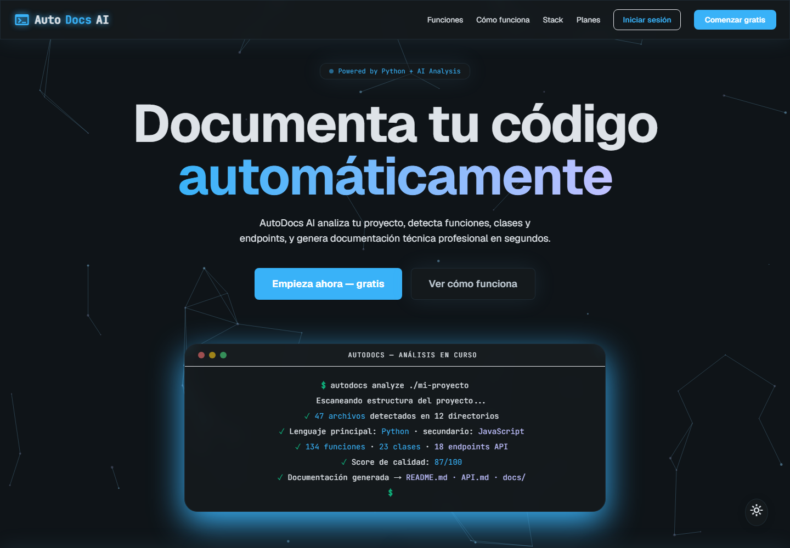
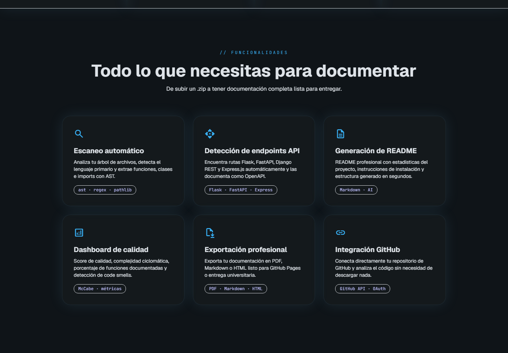
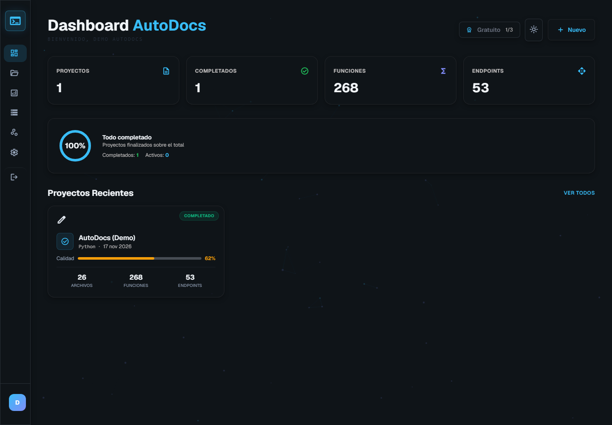
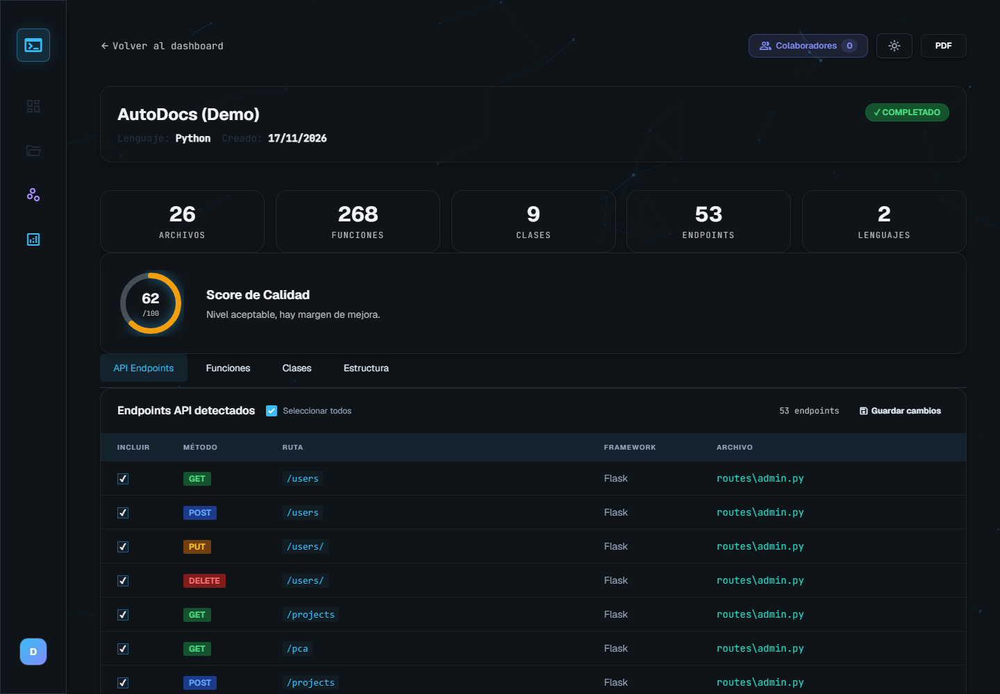
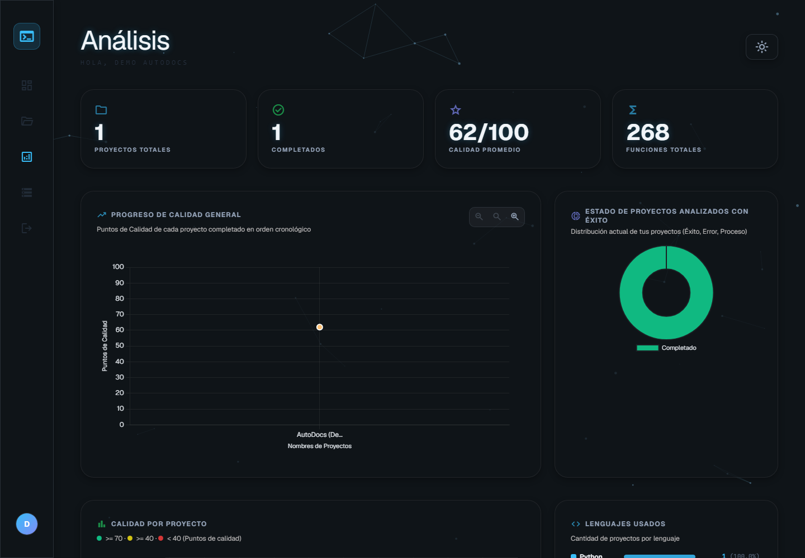
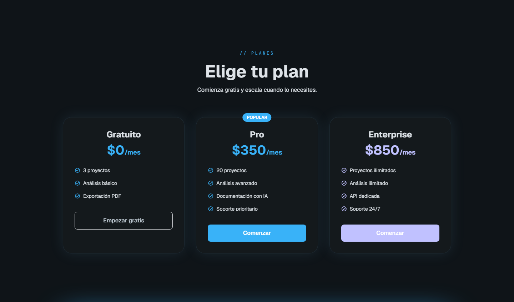
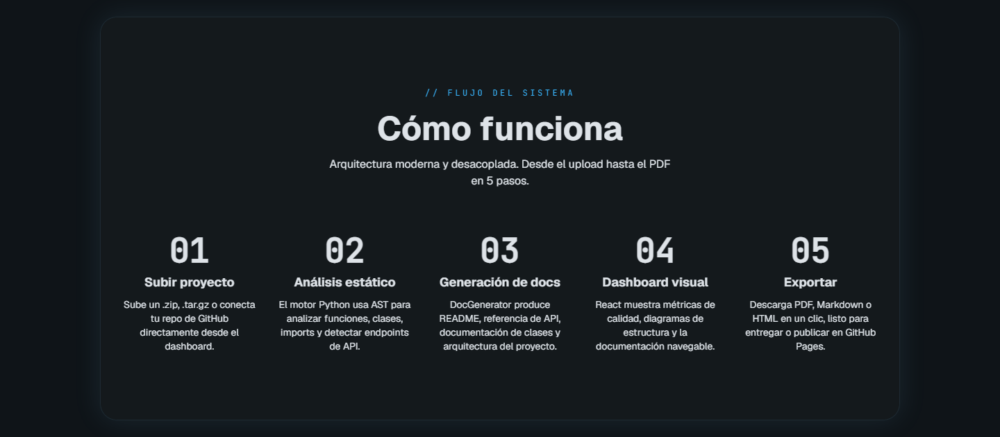
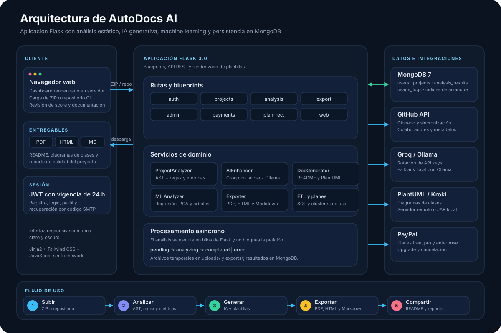

<p align="center">
  
</p>

<h1 align="center">AutoDocs AI</h1>

<p align="center">
  <strong>Documentación técnica automática para proyectos de software.</strong><br>
  Analiza el código, detecta su estructura y genera documentación lista para publicar.
</p>

<p align="center">
  
  
  
  
  
  
  
</p>

<p align="center">
  
</p>

> **Proyecto Integrador · Equipo 5** — AutoDocs AI es una aplicación web que convierte un repositorio o un ZIP en un paquete de documentación técnica: README, referencia de API, diagramas de clases, reporte de calidad y exportaciones PDF, HTML y Markdown.

---

## Contenido

- [Qué es AutoDocs AI](#qué-es-autodocs-ai)
- [Capturas de la aplicación](#capturas-de-la-aplicación)
- [Funcionalidades](#funcionalidades)
- [Arquitectura](#arquitectura)
- [Cómo funciona](#cómo-funciona)
- [Stack tecnológico](#stack-tecnológico)
- [Estructura del repositorio](#estructura-del-repositorio)
- [Instalación](#instalación)
- [Variables de entorno](#variables-de-entorno)
- [Uso rápido de la API](#uso-rápido-de-la-api)
- [API REST](#api-rest)
- [Pruebas](#pruebas)
- [Notas y limitaciones](#notas-y-limitaciones)
- [Contribuir](#contribuir)
- [Equipo](#equipo)
- [Licencia](#licencia)

---

## Qué es AutoDocs AI

AutoDocs AI recibe un proyecto empaquetado en ZIP, un archivo de código o la URL de un repositorio de GitHub. A partir de ese punto:

1. Recorre el árbol de archivos e ignora carpetas que no aportan información (`node_modules`, `.git`, `venv`, `dist`, `build`, entre otras).
2. Identifica el lenguaje dominante y analiza el código con **Python AST** y expresiones regulares.
3. Extrae funciones, clases, imports, docstrings, parámetros, endpoints y métricas de complejidad.
4. Calcula un **score de calidad** y detecta funciones con alta complejidad o sin documentar.
5. Genera la documentación con plantillas y, si hay un proveedor de IA configurado, enriquece la redacción.
6. Permite revisar el resultado en el dashboard y exportarlo en **PDF, HTML o Markdown**.

El contenido no es genérico: se construye con los nombres reales de las funciones, las rutas de los endpoints, la estructura de carpetas y los indicadores del proyecto analizado.

| Necesidad | Cómo la resuelve AutoDocs AI |
|---|---|
| La documentación se desactualiza | El análisis se ejecuta bajo demanda sobre el código actual |
| Revisar un proyecto ajeno toma horas | El árbol, las funciones, las clases y los endpoints se listan automáticamente |
| No hay un criterio objetivo de calidad | Score de 0 a 100, complejidad promedio y máxima, e issues detectados |
| Cada stack usa herramientas distintas | Análisis multi-lenguaje con detección de frameworks web |
| Entregar documentación es manual | Exportación a PDF, HTML y Markdown, más diagramas PlantUML |

---

## Capturas de la aplicación

### Funcionalidades y flujo de trabajo



*Landing page: las seis capacidades principales del producto.*

| Dashboard | Resultado del análisis |
|---|---|
|  |  |
| Proyectos recientes, estado del análisis y consumo del plan. | Score de calidad, endpoints, funciones, clases y estructura del proyecto. |

### Analítica y planes



*Analítica: métricas agregadas de los proyectos analizados.*

| Planes | Flujo de uso |
|---|---|
|  |  |
| Planes Gratuito, Pro y Enterprise. | Del ZIP al documento exportado en cinco pasos. |

---

## Funcionalidades

### Análisis estático multi-lenguaje

- Recorrido completo del proyecto con `pathlib` y detección del lenguaje dominante.
- Análisis profundo con AST para Python: funciones, clases, imports, docstrings, funciones asíncronas, parámetros y estimación de complejidad.
- Extracción de funciones y clases para JavaScript/TypeScript, React, Java, PHP, Ruby, Go, Rust, C#, Kotlin, Swift, C, C++, Elixir y Scala.
- Detección de endpoints en Flask, FastAPI, Express.js, NestJS, Spring/Ktor, Laravel, Rails/Sinatra, Go (Gin/Echo/Fiber), ASP.NET Core y Actix/Axum.
- Detección de más de 45 extensiones de archivo, incluyendo SQL, Shell, Terraform, GraphQL, YAML y Dockerfile.

### Score de calidad e indicadores

- `quality_score` de 0 a 100 calculado a partir de la estructura, la documentación y la complejidad.
- Complejidad promedio, complejidad máxima y conteo de funciones con alta complejidad.
- Porcentaje de funciones documentadas y listado de funciones sin docstring.
- Issues de análisis con archivo y causa, para distinguir código no analizable de código con problemas.
- Ranking de funciones y clases por tamaño y complejidad.

### Generación de documentación

El generador produce un paquete con varias secciones:

| Sección | Contenido |
|---|---|
| `readme` | Descripción del proyecto, instalación, estructura y uso |
| `architecture` | Componentes, carpetas y relaciones, con insights de IA cuando están disponibles |
| `api_docs` | Endpoints agrupados por método, ruta, archivo y framework |
| `quality_report` | Score, complejidad, cobertura de docstrings e issues |
| `full_markdown` | Documento consolidado con todas las secciones |
| Diagrama PlantUML | Diagrama de clases generado a partir de las clases detectadas |

### Enriquecimiento con IA

- Integración con **Groq** usando modelos compatibles como `qwen/qwen3.8-27b`, `openai/gpt-oss-120b`, `llama-3.3-70b-versatile` y `llama-3.1-8b-instant`.
- Rotación automática de varias API keys separadas por comas en `GROQ_API_KEY`.
- Fallback local a **Ollama** si hay un servidor disponible en `localhost:11434`.
- Limpieza y sanitización del Markdown generado antes de incorporarlo a los documentos.
- Si no hay proveedor de IA, el producto sigue funcionando con la generación basada en plantillas.

### Machine learning

- Regresión lineal simple y múltiple para relacionar funciones, complejidad, issues, tests y endpoints con la calidad.
- Regresión logística para estimar la probabilidad de que una función esté documentada.
- Análisis de error absoluto medio (MAE) y coeficiente de determinación (R²).
- PCA para visualizar y clasificar proyectos desde el panel de administración.
- Árbol de decisión para clasificar el tipo de proyecto.
- K-Means con método del codo y silhouette score para agrupar usuarios y recomendar un plan.

### Diagramas y exportación

- Diagramas de clases con **PlantUML**; el sistema intenta primero el servidor de PlantUML, luego **Kroki** y, si está disponible, un JAR local.
- Exportación a **PDF** con WeasyPrint y fallback a ReportLab.
- Exportación a **HTML** y **Markdown**.
- Tablas anchas pasan automáticamente a orientación horizontal en el PDF.
- Conversión de Markdown a HTML con Node.js (`remark`) y fallback a Python Markdown.

### Integración con GitHub

- Creación de proyectos a partir de una URL de repositorio.
- Extracción del propietario, nombre, descripción y metadatos del repositorio.
- Consulta de colaboradores mediante la API de GitHub.
- Sincronización del proyecto para volver a analizar cambios.
- Selección de la rama que se analiza desde el dashboard.
- Sondeo automático de la rama seleccionada cada 5 minutos mientras el dashboard está abierto (planes Pro y Enterprise); no requiere configurar un webhook.

El webhook sigue disponible como alternativa para recibir cambios al instante. Para activarlo, configura `GITHUB_WEBHOOK_SECRET` en el entorno de AutoDocs y agrega un webhook en **Settings → Webhooks → Add webhook** del repositorio:

1. Usa la URL pública `https://<tu-dominio>/api/integrations/github/webhook` y elige `application/json`.
2. Usa el mismo valor de `GITHUB_WEBHOOK_SECRET` como **Secret**.
3. Selecciona los eventos **Pushes** y **Branch or tag creation**. AutoDocs ignora la creación de tags.
4. Guarda el webhook. Los commits y las ramas aparecerán en **Insights → Actividad GitHub**; cada revisión nueva se analizará automáticamente.

La URL debe ser accesible desde GitHub y usar HTTPS. El proyecto debe estar registrado en AutoDocs desde su URL de GitHub.

### Cuentas, planes y administración

- Registro y login con JWT de 24 horas.
- Recuperación de contraseña mediante código de seis dígitos enviado por SMTP.
- Planes **Gratuito** (3 proyectos), **Pro** (20 proyectos) y **Enterprise** (proyectos ilimitados).
- Seguimiento de uso por usuario y recomendación de plan basada en clústeres.
- Panel de administración con usuarios, proyectos, métricas globales, PCA y clasificación de proyectos.

---

## Arquitectura



La aplicación se organiza en cuatro capas:

| Capa | Responsabilidad |
|---|---|
| Cliente | Navegador con dashboard renderizado en servidor, carga de proyectos y descarga de documentos |
| Aplicación Flask | Blueprints de autenticación, proyectos, análisis, exportación, pagos, planes y administración |
| Servicios de dominio | Analizador, generador de documentación, enriquecedor con IA, ML, ETL, exportador y recomendador de planes |
| Datos e integraciones | MongoDB, GitHub, Groq/Ollama, PlantUML/Kroki y PayPal |

El análisis se ejecuta en hilos en segundo plano. El proyecto pasa por los estados `pending`, `analyzing`, `completed` o `error`, y los resultados se guardan en la colección `analysis_results` de MongoDB.

---

## Cómo funciona

1. **Subir el proyecto.** Se acepta un ZIP, un archivo de código o una URL de GitHub. El tamaño máximo de carga es de 50 MB.
2. **Analizar la estructura.** El analizador recorre carpetas, detecta lenguajes, lee archivos y extrae funciones, clases, imports y endpoints.
3. **Calcular la calidad.** Se estima la complejidad, se mide la documentación existente y se genera el score con los issues encontrados.
4. **Generar la documentación.** El generador crea el README, la arquitectura, la referencia de API y el reporte de calidad; la IA puede mejorar la redacción.
5. **Revisar y exportar.** El dashboard muestra el resultado y permite descargar PDF, HTML o Markdown, además de los diagramas generados.

---

## Stack tecnológico

<p align="center">
  
  
  
  
  
  
  
  
</p>

| Capa | Tecnología | Uso en el proyecto |
|---|---|---|
| Backend | Python 3.12, Flask 3.0, Gunicorn | API REST y renderizado de plantillas |
| Autenticación | Flask-JWT-Extended, Werkzeug | Tokens de 24 h y hash de contraseñas |
| Base de datos | MongoDB 7, PyMongo | Usuarios, proyectos, resultados y logs de uso |
| Análisis | `ast`, `re`, `pathlib` | Estructura, funciones, clases, endpoints y complejidad |
| IA | Groq API, Ollama | Enriquecimiento de la documentación |
| Machine learning | scikit-learn, pandas, numpy | Regresiones, PCA, árbol de decisión y K-Means |
| Diagramas | PlantUML, Kroki | Diagramas de clases |
| Exportación | Markdown, WeasyPrint, ReportLab | PDF, HTML y Markdown |
| Frontend | Jinja2, Tailwind CSS, JavaScript vanilla | Dashboard responsive con tema claro y oscuro |
| GitHub | PyGithub, git, API REST | Clonado, colaboradores y sincronización |
| Pagos | PayPal, API de planes | Upgrade y cancelación de plan |
| Infraestructura | Docker, Docker Compose | Contenedor de la aplicación y MongoDB local |

---

## Estructura del repositorio

```text
autoDocs/
├── app.py                     # Fábrica de la aplicación Flask y registro de blueprints
├── config.py                  # Configuración, JWT, MongoDB, uploads y exports
├── Dockerfile                 # Imagen Python 3.12 con WeasyPrint, Node y PlantUML
├── docker-compose.yml         # App, MongoDB 7 y Mongo Express
├── markdown_to_html.js        # Conversión de Markdown a HTML con remark
├── requirements.txt           # Dependencias de ejecución
├── requirements-test.txt      # Dependencias para pruebas y CI
├── pytest.ini                 # Configuración de pytest
├── routes/
│   ├── auth.py                # Registro, login, perfil y recuperación
│   ├── projects.py            # CRUD de proyectos, GitHub y colaboradores
│   ├── analysis.py            # Análisis, predicciones, ETL y SQL
│   ├── export.py              # Exportación PDF, HTML y Markdown
│   ├── payments.py            # Planes, upgrade y cancelación
│   ├── plan_recommendation.py # Recomendación de plan por uso
│   ├── admin.py               # Administración, PCA y clasificación
│   └── web.py                 # Rutas HTML renderizadas con Jinja2
├── services/
│   ├── analyzer.py            # Motor de análisis estático
│   ├── ai_enhancer.py         # Groq con rotación de keys y fallback a Ollama
│   ├── doc_generator.py       # README, arquitectura, API y calidad
│   ├── exporter.py            # PDF, HTML y Markdown
│   ├── ml_analyzer.py         # Regresiones, PCA y árbol de decisión
│   ├── etl_pipeline.py        # Pipeline ETL y análisis de datos
│   ├── plan_recommender.py    # K-Means y recomendación de planes
│   ├── github_client.py       # Metadatos y colaboradores de GitHub
│   ├── file_handler.py        # Carga, extracción y clonado de repositorios
│   ├── data_cleaner.py        # Limpieza de datos para los modelos
│   └── db.py                  # Conexión e índices de MongoDB
├── templates/                 # Vistas Jinja2 del producto
├── static/                    # CSS, JavaScript y tema claro/oscuro
├── tests/                     # Suite de pruebas con pytest
├── scripts/                   # Utilidades de verificación y administración
├── utils/                     # Timeouts y seguimiento de uso
├── docs/                      # Documentación y capturas del README
├── uploads/                   # Proyectos cargados (generado en ejecución)
└── exports/                   # Documentos generados (generado en ejecución)
```

---

## Instalación

### Requisitos

- Python 3.12 (también funciona con 3.11)
- Node.js 18 o superior, necesario para `markdown_to_html.js`
- MongoDB 7 local o una instancia de MongoDB Atlas
- Git, para clonar repositorios desde GitHub
- Java y PlantUML, solo si se quieren generar diagramas con un JAR local

### Clonar e instalar

```bash
git clone https://github.com/Organizacion-equipo-5/autoDocs.git
cd autoDocs

python -m venv .venv

# Windows
.venv\Scripts\activate

# Linux / macOS
source .venv/bin/activate

pip install -r requirements.txt
npm ci
```

### Configurar el entorno

```bash
# Windows
copy .env.example .env

# Linux / macOS
cp .env.example .env
```

Edita `.env` con tus valores. Como mínimo, configura `MONGO_URI`, `SECRET_KEY` y `JWT_SECRET_KEY`. No uses las credenciales de ejemplo en producción.

### Ejecutar en desarrollo

```bash
python app.py
```

La aplicación queda disponible en `http://localhost:5000`.

Para ejecutar con Gunicorn:

```bash
gunicorn --bind 0.0.0.0:5000 --workers 2 --timeout 120 "app:create_app()"
```

### Docker

```bash
docker build -t autodocs .
docker run --rm -p 5000:5000 --env-file .env autodocs
```

El `docker-compose.yml` incluye MongoDB 7 y Mongo Express. Si lo usas con Compose, el contexto de build debe apuntar a la raíz del repositorio (`build: .`), porque el `Dockerfile` está en la raíz y no en una carpeta `backend/`.

### Crear un administrador

```bash
python scripts/create_admin.py \
  --email admin@ejemplo.com \
  --name "Admin" \
  --password "UnaClaveSegura123"
```

---

## Variables de entorno

| Variable | Obligatoria | Descripción |
|---|---|---|
| `SECRET_KEY` | Sí | Clave de Flask para sesiones y formularios |
| `JWT_SECRET_KEY` | Sí | Clave con la que se firman los tokens JWT |
| `MONGO_URI` | Sí | Cadena de conexión de MongoDB |
| `GITHUB_TOKEN` | No | Token opcional para aumentar el límite de consultas a la API de GitHub |
| `GITHUB_WEBHOOK_SECRET` | No | Secreto para verificar la firma del webhook opcional de GitHub |
| `FLASK_DEBUG` | No | `True` o `False`; por defecto `True` en desarrollo |
| `UPLOAD_FOLDER` | No | Carpeta de proyectos cargados; por defecto `./uploads` |
| `EXPORT_FOLDER` | No | Carpeta de documentos generados; por defecto `./exports` |
| `GROQ_API_KEY` | No | Una o varias API keys de Groq separadas por comas; usa `openai/gpt-oss-120b` por defecto |
| `ENABLE_AI_ANALYSIS` | No | Activa el enriquecimiento de descripciones con Groq cuando hay una clave configurada; `false` lo desactiva |
| `PLANTUML_SERVER_URL` | No | Servidor PlantUML alternativo; por defecto se intenta PlantText primero |
| `PLANTUML_JAR_PATH` | No | Ruta a un `plantuml.jar` local |
| `PAYPAL_CLIENT_ID` | No | Client ID de PayPal para el botón de pago |
| `SMTP_HOST`, `SMTP_PORT`, `SMTP_USER`, `SMTP_PASSWORD` | No | Servidor de correo para recuperar contraseñas |
| `EMAIL_USER` | No | Remitente de los correos de recuperación |

---

## Uso rápido de la API

```bash
# 1. Registrar un usuario
curl -X POST http://localhost:5000/api/auth/register \
  -H "Content-Type: application/json" \
  -d '{"name":"Ana","email":"ana@ejemplo.com","password":"Segura123"}'

# 2. Iniciar sesión y guardar el token
curl -X POST http://localhost:5000/api/auth/login \
  -H "Content-Type: application/json" \
  -d '{"email":"ana@ejemplo.com","password":"Segura123"}'

# 3. Crear un proyecto desde un ZIP
curl -X POST http://localhost:5000/api/projects/ \
  -H "Authorization: Bearer $TOKEN" \
  -F "name=mi-api" \
  -F "description=API de ejemplo" \
  -F "file=@mi-api.zip"

# 4. Iniciar el análisis
curl -X POST http://localhost:5000/api/analysis/<PROJECT_ID>/start \
  -H "Authorization: Bearer $TOKEN"

# 5. Consultar el estado
curl http://localhost:5000/api/analysis/<PROJECT_ID>/status \
  -H "Authorization: Bearer $TOKEN"

# 6. Descargar el PDF
curl http://localhost:5000/api/export/<PROJECT_ID>/pdf \
  -H "Authorization: Bearer $TOKEN" \
  -o documentacion.pdf
```

También se puede crear un proyecto desde GitHub:

```bash
curl -X POST http://localhost:5000/api/projects/ \
  -H "Authorization: Bearer $TOKEN" \
  -F "name=mi-repositorio" \
  -F "github_url=https://github.com/usuario/repositorio"
```

---

## API REST

### Autenticación

| Método | Endpoint | Descripción |
|---|---|---|
| `POST` | `/api/auth/register` | Registrar usuario y devolver JWT |
| `POST` | `/api/auth/login` | Iniciar sesión |
| `GET` | `/api/auth/me` | Perfil del usuario autenticado |
| `PUT` | `/api/auth/me` | Actualizar nombre o contraseña |
| `POST` | `/api/auth/forgot-password` | Enviar código de recuperación |
| `POST` | `/api/auth/verify-code` | Verificar el código de seis dígitos |
| `POST` | `/api/auth/reset-password` | Cambiar la contraseña |

### Proyectos

| Método | Endpoint | Descripción |
|---|---|---|
| `GET` | `/api/projects/` | Listar los proyectos del usuario |
| `POST` | `/api/projects/` | Crear un proyecto con ZIP o URL de GitHub |
| `GET` | `/api/projects/:id` | Obtener un proyecto |
| `PUT` | `/api/projects/:id` | Actualizar nombre o descripción |
| `DELETE` | `/api/projects/:id` | Eliminar un proyecto |
| `GET` | `/api/projects/:id/contributors` | Consultar colaboradores |
| `POST` | `/api/projects/:id/contributors/refresh` | Refrescar colaboradores |
| `POST` | `/api/projects/:id/sync` | Sincronizar con GitHub |

### Insights e integración con GitHub

| Método | Endpoint | Descripción |
|---|---|---|
| `GET` | `/api/insights/:id/history` | Historial de snapshots y tendencia |
| `GET` | `/api/insights/:id/activity` | Actividad reciente de commits y creación de ramas |
| `GET` | `/api/insights/:id/compare` | Comparación de dos snapshots |
| `GET` | `/api/integrations/github/projects/:id/branches` | Listar ramas disponibles |
| `POST` | `/api/integrations/github/projects/:id/branch` | Seleccionar y analizar una rama |
| `POST` | `/api/integrations/github/projects/:id/poll` | Revisar cambios en la rama seleccionada |
| `POST` | `/api/integrations/github/webhook` | Recibir eventos `push` y `create` de GitHub (firma HMAC-SHA256) |

### Análisis

| Método | Endpoint | Descripción |
|---|---|---|
| `POST` | `/api/analysis/:id/start` | Iniciar el análisis en segundo plano |
| `GET` | `/api/analysis/:id/status` | Consultar el estado |
| `GET` | `/api/analysis/:id/results` | Obtener resultados y documentación |
| `GET` | `/api/analysis/:id/predictions` | Predicciones de machine learning |
| `POST` | `/api/analysis/suggest-docstring` | Sugerir un docstring con IA |
| `POST` | `/api/analysis/analyze` | Analizar un proyecto ya cargado |
| `POST` | `/api/analysis/etl` | Ejecutar el pipeline ETL |
| `GET` | `/api/analysis/etl/diagram` | Obtener el diagrama del ETL |
| `POST` | `/api/analysis/database/analyze-sql` | Analizar una base de datos SQL |
| `GET` | `/api/analysis/database/history` | Historial de análisis SQL |
| `GET` | `/api/analysis/database/history/:id` | Detalle de un análisis SQL |
| `POST` | `/api/analysis/database/download-pdf` | Descargar el reporte SQL en PDF |

### Exportación

| Método | Endpoint | Descripción |
|---|---|---|
| `GET` | `/api/export/:id/pdf` | Generar y descargar PDF |
| `GET` | `/api/export/:id/html` | Generar y descargar HTML |
| `GET` | `/api/export/:id/markdown` | Generar y descargar Markdown |

### Planes y pagos

| Método | Endpoint | Descripción |
|---|---|---|
| `GET` | `/api/payments/plans` | Consultar los planes disponibles |
| `POST` | `/api/payments/upgrade` | Actualizar el plan del usuario |
| `GET` | `/api/payments/my-plan` | Consultar el plan actual |
| `POST` | `/api/payments/cancel` | Cancelar la suscripción |
| `GET` | `/api/plan-recommendation/me` | Recomendación de plan según el uso |

### Administración

| Método | Endpoint | Descripción |
|---|---|---|
| `GET`, `POST` | `/api/admin/users` | Listar y crear usuarios |
| `PUT`, `DELETE` | `/api/admin/users/:id` | Editar y eliminar usuarios |
| `GET`, `POST` | `/api/admin/projects` | Listar y crear proyectos |
| `PUT`, `DELETE` | `/api/admin/projects/:id` | Editar y eliminar proyectos |
| `GET` | `/api/admin/overview` | Métricas globales |
| `GET` | `/api/admin/pca` | Datos del análisis PCA |
| `GET` | `/api/admin/classify-project/:id` | Clasificar un proyecto |
| `GET` | `/api/admin/classify-all-projects` | Clasificar todos los proyectos |

### Vistas web

| Ruta | Vista |
|---|---|
| `/` | Landing page con registro, login y planes |
| `/dashboard` | Panel principal del usuario |
| `/projects` | Listado y gestión de proyectos |
| `/analysis/<id>` | Resultados del análisis |
| `/analytics` | Analítica agregada |
| `/ml-predictions` | Predicciones de machine learning |
| `/plan-recommendation` | Recomendación de plan |
| `/database-analysis` | Análisis de bases de datos SQL |
| `/perfil` | Perfil del usuario |
| `/pricing` | Planes y precios |
| `/admin`, `/admin/users`, `/admin/projects`, `/admin/pca` | Administración |

---

## Pruebas

```bash
pip install -r requirements-test.txt
pytest
```

La suite incluye pruebas de la capa de IA, limpieza de datos, generación de documentación, exportación, cliente de GitHub y modelos de machine learning. Para ejecutar solo un módulo:

```bash
pytest tests/test_doc_generator.py -v
```

También existe una verificación integral del flujo de generación:

```bash
python scripts/verify_full_flow.py
```

El reporte de calidad más reciente está en [`QA_REPORT/`](QA_REPORT/). Allí se documentan las pruebas ejecutadas, los errores encontrados y las recomendaciones de seguridad.

---

## Notas y limitaciones

- **IA opcional.** Sin `GROQ_API_KEY` y sin Ollama, la generación de documentación sigue funcionando con plantillas, pero se omite el enriquecimiento con lenguaje natural.
- **Diagramas.** PlantUML puede generar los diagramas con el servidor público o con Kroki. Para un entorno sin red se necesita el JAR local y Java instalado.
- **PDF en Windows.** Para generar PDF con WeasyPrint instala MSYS2 y ejecuta `C:\msys64\usr\bin\pacman.exe -S --needed mingw-w64-ucrt-x86_64-pango mingw-w64-ucrt-x86_64-cairo mingw-w64-ucrt-x86_64-gdk-pixbuf`. El exportador busca las DLL en `C:\msys64\ucrt64\bin`; si MSYS2 está en otra ruta, configura `WEASYPRINT_DLL_DIRECTORIES` con el directorio `bin` correspondiente. Sin estas DLL, se usa ReportLab como respaldo.
- **Pagos.** El módulo de pagos está integrado con PayPal y con una actualización de plan validada en el backend; no procesa cobros reales en el entorno de desarrollo.
- **Docker Compose.** El `docker-compose.yml` actual apunta el build a `./backend`, mientras que el `Dockerfile` está en la raíz. Ajusta el contexto a `build: .` o usa el comando `docker build` de este README.
- **Credenciales.** `config.py` y `.env.example` contienen valores de ejemplo. Cámbialos y no publiques claves reales en el repositorio.

---

## Contribuir

1. Haz un fork del repositorio.
2. Crea una rama descriptiva: `git checkout -b feature/nueva-funcionalidad`.
3. Implementa el cambio y agrega pruebas cuando aplique.
4. Ejecuta `pytest` antes de enviar.
5. Haz commit con un mensaje claro: `git commit -m "feat: agregar nueva funcionalidad"`.
6. Sube la rama y abre un Pull Request.

---

## Equipo

Proyecto Integrador desarrollado por el **Equipo 5** para la organización [Organizacion-equipo-5](https://github.com/Organizacion-equipo-5).

Repositorio: [github.com/Organizacion-equipo-5/autoDocs](https://github.com/Organizacion-equipo-5/autoDocs)

---

## Licencia

Distribuido bajo la licencia **MIT**.
